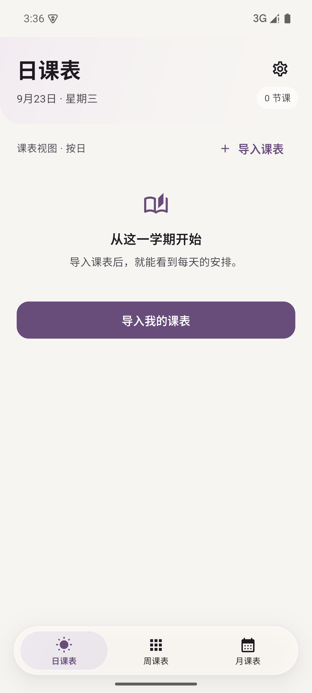
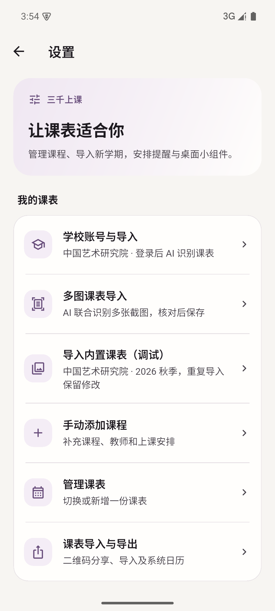

  
  <h1>三千上课</h1>
  
把课程安排好，每天上课一眼看清。

三千上课是一款面向学生的个人课表 App。导入或录入课程后，可以按日、周、月查看安排，并用提醒和桌面小组件减少忘课、找教室的麻烦。

## 看看界面

<table>
  <tr>
    <td align="center"> 日课表：快速查看当天安排</td>
    <td align="center"> 设置：导入、提醒、小组件与外观</td>
  </tr>
</table>

## 可以做什么

- **导入课程**：用学校账号或课程截图导入。学校账号导入目前只支持中国艺术研究院，其他学校还在适配。识别结果可以核对后再保存，也可以手动添加课程。
- **本机记住账号和密钥**：学校账号和密码会保存在本机，密码只显示脱敏内容。AI 识别用的 API Key 同样只留在本机，保存后以脱敏形式显示。
- **查看安排**：在日、周、月课表中查看课程时间、地点和教师。
- **提醒与外观**：设置上课提醒，添加桌面小组件。显示外观可以跟随系统，也可以固定为浅色或深色。
- **管理与分享**：管理多份学期课表，用二维码导入或分享，也可以把课程导出到系统日历。
- **离线查看**：已保存的课表存在本机，可以离线查看。学校调课后，请以学校最新通知为准。

适合想更方便地整理课程、查看每天安排的高校学生，以及其他需要管理个人课程表的人。

## 平台

Android · iOS
